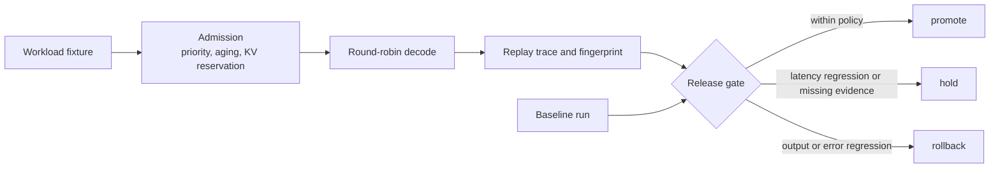

# Deterministic Inference Scheduler

[](https://github.com/WaffleBits/deterministic-inference-scheduler/actions/workflows/ci.yml)

A Rust model of how an LLM server admits requests, shares KV-cache memory and
decides if a new build is safe to release. The same input always produces the
same trace, so a scheduling change can be compared exactly against a baseline.

## Result

128 generated property cases check that replay is identical and that every KV page
reserved is returned. On the workload fixture, four requests finish in 11 ticks, KV
usage peaks at 12 of 20 pages, and the fingerprint `b454ea97ea75ee90` reproduces on
every run. These are synthetic workloads, so they prove behavior, not production
performance.

## How it works



## Run it

```bash
cargo test --all-targets
cargo run --release -- replay --input fixtures/workload.json --output artifacts/workload-replay.json
cargo run --release -- gate --input fixtures/release_gate_bad.json --output artifacts/release-gate-rollback.json
```

The last command produces `rollback`, because the candidate has an output mismatch
and an added error. `fixtures/release_gate_safe.json` produces `promote`.

## Design decisions

1. **Reserve KV pages at admission.** A request reserves its full declared context
   before it starts, so an admitted request cannot run out of memory mid-decode.
   Sizes are widened before rounding and the capacity check uses checked addition,
   so overflow near the `u32` limit cannot become an admission.
2. **Age priority so nothing starves.** Queued requests gain one priority point
   every 32 ticks by default. A fixture proves an older low-priority request is
   admitted while higher-priority work keeps arriving.
3. **Separate hold from rollback.** Wrong outputs and added errors roll back.
   Latency regressions and missing evidence hold for a person to look at. Each
   outcome names the failed signal and the next action.

## Limitations

- It schedules and accounts for work, and does not run model kernels.
- There is one host, no distributed coordination and no real traffic.
- Generated fixtures broaden coverage of the model but are not production traces.

## More

- [Runtime model and invariants](docs/RUNTIME_MODEL.md)
- [Architecture](docs/ARCHITECTURE.md)
- [Release validation](docs/RELEASE_VALIDATION.md)
